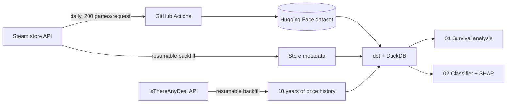

# Steam-SaleWaitingGame

**Should you buy that Steam game now, or wait for a sale?**

A data pipeline and set of models that track the price of every game on Steam, learn from ten
years of sale history, and estimate how likely a game is to go on sale soon and how deep the
discount will be.

> Status: data collection live · dbt warehouse built · first two models done · Winter Sale 2026 live test in progress

---

## What's in here

| Layer | What it does | Tools |
|---|---|---|
| **Daily snapshot** | Price and discount for all ~202,000 Steam games, every day | Python, GitHub Actions, Hugging Face Datasets |
| **Backfills** | Store metadata for every game, and up to 10 years of past Steam sales per game | Python, Windows Task Scheduler, IsThereAnyDeal API |
| **Warehouse** | Cleans and models everything into tested tables (sale events, sale gaps, game dimension, platform sale calendar) | dbt, DuckDB |
| **Models** | Survival analysis (time until next sale) and a classifier (sale within 14 days?) | lifelines, scikit-learn, LightGBM, SHAP |



## Findings so far

**Steam's sale calendar can be recovered from the data alone.** Counting how many games start a
sale each day shows clear spikes (100–400× a normal day) for every seasonal sale. No dates were
entered by hand. It also shows that **Steam moved its Autumn Sale from late November (2023, 2024)
to late September/October (2025, 2026)**, so a model that hard-codes "the Autumn Sale is in
November" would have been wrong for two years.

**Survival analysis** (`notebooks/01_survival_time_to_next_sale.ipynb`, ~92,000 gaps between sales):
- The median wait between a game's sales is **31 days**. About 49% of games go on sale again within 30 days, and 85% within 90 days.
- **Distance to the next major Steam sale** is the strongest predictor of when the next sale comes, followed by each game's own discount habit.
- A Cox model beat the "just wait for the next seasonal sale" baseline on 2025–26 data (**c-index 0.663 vs 0.627**). The baseline did better on older data, which suggests Steam sales have become less tied to the big seasonal events.

**Classifier** (`notebooks/02_classifier_sale_within_14_days.ipynb`): LightGBM vs logistic
regression vs the seasonal rule vs Cox, with every game weighted equally and SHAP explanations.
*(Results in the notebook.)*

## Data quality: what the tests caught

The dbt tests caught real problems on the first run against real data, each fixed at the model level:

- **Same-timestamp price ties** in the history created zero-length sales. Fixed by keeping one row per moment.
- **Sale IDs collided** when a game's sale ended and a new one started on the same day. Fixed by numbering sales per game.
- **Left-censoring:** about 13,000 games were already on sale on the first snapshot day, which made it look like 13,000 sales *started* that day. Fixed by flagging sales whose true start date is unknown and excluding them from anything that uses start dates.
- **Overlapping events:** Steam fests that share a day caused duplicate calendar rows. Fixed by combining them.
- **A non-game in the game list:** Steam Gift Cards (`type = advertising`). Excluded from modelling, kept as a warning-level test.

## Project structure

```
steamwait/              Python pipeline
  app_list.py             every game on Steam (games only)
  snapshot_prices.py      daily prices, batched 200 per request
  price_history.py        daily snapshots -> price periods (change data capture)
  fetch_details.py        metadata backfill, resumable
  itad_history.py         IsThereAnyDeal history backfill, resumable, priority-ordered
  parse_*.py              raw JSON -> parquet
  hf_sync.py              upload/download the Hugging Face dataset
dbt/                    warehouse models and tests (staging -> intermediate -> marts)
notebooks/              analysis and models (CPSC 330 style)
scripts/                helpers: run_dbt.py, query.py, Task Scheduler .bat files
tests/                  pytest unit tests for the pipeline
.github/workflows/      daily price snapshot (with a backup run that skips if already done)
```

## Running it

```bash
# pipeline (Windows venv)
python -m pip install -r requirements.txt -r requirements-dbt.txt
python -m steamwait.hf_sync download          # latest daily snapshots
python -m steamwait.parse_details
python -m steamwait.parse_itad
python scripts/run_dbt.py build               # models + tests

# notebooks (Linux / WSL venv, see note below)
pip install -r requirements-ml.txt
```

Keys go in `.env` (see `.env.example`): `STEAM_API_KEY`, `ITAD_API_KEY`, `HF_TOKEN`.

**Windows note:** Smart App Control blocks some compiled scientific libraries (scipy), so the
notebooks run in WSL (Ubuntu). The pipeline and dbt run on Windows.

## Data sources and how they're used

- **Steam:** public store endpoints and the Steam Web API, within their rate limits
  (about 200 store requests per 5 minutes; the daily snapshot batches 200 games per request).
- **[IsThereAnyDeal](https://isthereanydeal.com):** historical Steam prices in CAD, via their
  official API, paced at about 60% of the account's rate limit. Their raw price history is
  not republished here; it is used only to build and evaluate the models.
- **Not used:** SteamDB, which asks not to be scraped.
- **Content filtering:** games carrying Steam's adult content descriptors (IDs 3 and 4) are
  excluded from modelling. The rule was chosen by checking real examples, after confirming that
  mainstream games such as Cyberpunk 2077 and Baldur's Gate 3 carry descriptor 1 but never 3 or 4.

## Roadmap

- [x] Daily snapshot of every Steam game
- [x] Metadata and 10-year price history backfills
- [x] dbt warehouse with tests
- [x] Survival analysis (Kaplan-Meier, Cox)
- [x] Classifier with SHAP explanations
- [ ] Tune with `TimeSeriesSplit` and check calibration
- [ ] Freeze predictions before the Winter Sale (Dec 17, 2026), then score them afterwards
- [ ] Discount-depth model ("probably 50–75% off")
- [ ] LLM layer: map Steam fest themes to games, with a hand-labelled evaluation set
- [ ] "Wait or buy" web app and an MCP server so AI assistants can query it

---

Built by [Arya Sardesai](https://arya-sardesai.netlify.app) · Price history courtesy of IsThereAnyDeal
